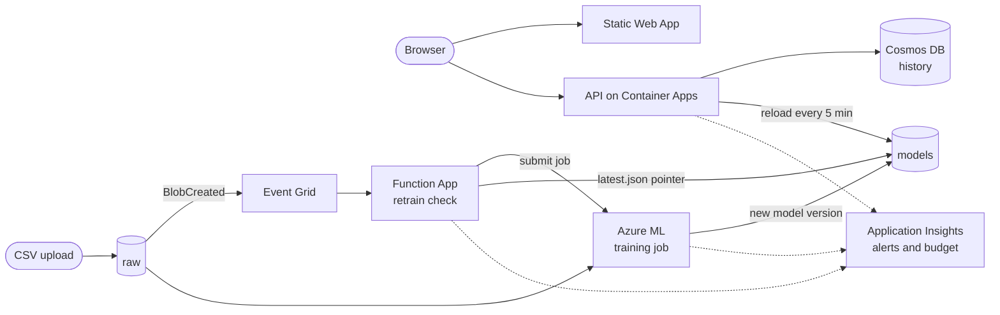

# Bank churn on Azure

A bank wants to know which customers are about to leave. This project predicts that from ten account fields (credit score, age, country, balance, products held and so on), explains each prediction, and keeps the model current as new data arrives. It runs on Azure and is deployed from code.

Live demo: https://proud-grass-091798800.3.azurestaticapps.net. The API scales to zero, so the first request after a quiet period takes about 15 seconds.

## What it does

- **Scores a customer** and shows the churn probability, plus the factors that raised or lowered it.
- **Scores a CSV** of up to 500 customers and ranks them by risk.
- **Shows the training data**: churn rate by age, credit score, balance, country, gender and number of products.
- **Shows the model**: accuracy, F1, confusion matrix, calibration, results by group and a comparison of the candidate models.
- **Keeps a history** of each browser's recent scores in Cosmos DB. The demo is public, so history is scoped to a random session id rather than shared.
- **Retrains itself.** Upload new labelled customer CSVs to the `raw` container and, once 1000 new rows have arrived, an Azure ML job trains again. The new model is published as a versioned bundle behind a pointer file, and the API picks it up within five minutes without a restart.

## The model

Each training run fits five models on 80% of the data: logistic regression, random forest, extra trees, gradient boosting and a small neural network. Every model is wrapped in probability calibration, so a score of 30% means roughly 30% of such customers churn. Only about one customer in five churns, so each model's cut-off is tuned for F1 on out-of-fold predictions instead of using 50%. The model with the best cross-validated F1 is reported on the held-out 20% and published.

Running `make train` on the 10,000-row dataset gives this table:

| Model | CV F1 | CV AUC | Test F1 | Test AUC | Test accuracy |
|---|---|---|---|---|---|
| Logistic regression | 0.492 | 0.766 | 0.491 | 0.755 | 75.5% |
| Random forest | 0.618 | 0.853 | 0.664 | 0.873 | 86.5% |
| Extra trees | 0.603 | 0.846 | 0.615 | 0.865 | 82.1% |
| Gradient boosting (selected) | 0.618 | 0.857 | 0.641 | 0.879 | 84.3% |
| Neural network | 0.607 | 0.848 | 0.633 | 0.863 | 85.2% |

Random forest and gradient boosting tie on cross-validated F1; the tie goes to the higher cross-validated AUC. Customers are assigned to the 20% held-out set by hashing `CustomerId`, so the same customers stay held out as data grows. A retrained model only replaces the one in service if it scores at least as well on those held-out rows and does not widen the gap in recall between countries or genders by more than 0.10. `/explain` works for any model: it swaps each feature for the training-set median or mode and reports how much the churn probability moves. Every model bundle ships with a SHA-256 manifest, and the API refuses a bundle that does not match it.

The live demo has moved on since that run, which is the whole point of the retraining loop. It now serves a random forest: 0.715 F1, 0.913 AUC, 88.8% accuracy, flagging churn at 37% or above, trained on a 13,000-row dataset (10,375 for training, 2,625 held out). The pipeline counted the rows it had not trained on, ran a job, compared the new model against the one in service on the same held-out rows and swapped it in without a redeploy. The Model tab of the demo shows the current numbers.

## Architecture



[docs/architecture.md](docs/architecture.md) has the full diagram with the storage accounts, Key Vault, timers and monitoring, and covers the request path, retraining, access control, scaling and regions in detail.

### Azure services

| Service | What it does here |
|---|---|
| Container Apps | Runs the FastAPI service, scaling from zero to one replica |
| Static Web Apps | Hosts the web page |
| Cosmos DB | Stores scores for the history view, expiring after 30 days |
| Storage (Data Lake Gen2) | Holds uploaded training CSVs, retrain state and versioned model bundles |
| Storage (host) | Separate account for the Function's package and host state |
| Event Grid | Fires when a CSV is uploaded |
| Functions (Flex Consumption) | Counts new rows on upload and on a weekly timer, submits the training job, tracks it to completion and publishes the result |
| Azure ML | Runs training on a CPU cluster that scales to zero |
| Key Vault | Required by the ML workspace |
| Application Insights, Log Analytics | Logs, traces, a 5xx alert and a failed-retrain alert |
| Cost Management | Monthly budget with email alerts |
| Managed identity and RBAC | Every service reaches storage and Cosmos DB without keys |

Infrastructure is a single Bicep file, `infra/bicep/main.bicep`. GitHub Actions runs the tests and scans first, then builds the image to GHCR, deploys the Bicep, publishes the code using OIDC with no stored credentials, and finishes by scoring a known customer against the live API.

## Repository

| Path | What is in it |
|---|---|
| `api/` | FastAPI service: `/predict`, `/explain`, `/batch_predict`, `/metrics`, `/stats`, `/feature_importance`, `/history`. Optional `X-API-Key` and JWT checks |
| `training/` | Fits and compares the candidate models and writes the model, metrics, feature importance, dataset stats and manifest |
| `functions/` | Retrain state machine (count, submit, poll, publish), guarded by a blob lease so simultaneous uploads run one check |
| `web/` | Plain HTML and JavaScript front end, no build step |
| `infra/` | Bicep template and the deploy script |
| `.github/workflows/` | CI (lint, tests, Bicep build, Trivy scans) and the deploy pipeline, which only runs once CI passes |
| `data/` | Where the training CSV goes; see [data/README.md](data/README.md) |

## Run it locally

You need Python 3.11 or newer and the dataset in `data/raw/churn.csv`.

```bash
make install
make train
make test
make api
python -m http.server 5500 -d web
```

The API is on http://localhost:8000 (interactive docs at `/docs`) and the page on http://localhost:5500. `web/config.js` points the page at the local API. Without Cosmos DB configured, the API keeps the last 200 scores in memory.

## Deploy

Run `az login` and register the resource providers once: `az provider register -n Microsoft.DocumentDB`, then the same for `Microsoft.EventGrid` and `Microsoft.MachineLearningServices`.

### With GitHub Actions

Pushing to `main` runs `ci.yml` (lint, tests, Bicep build, Trivy scans) and `deploy.yml` (CI again as a gate, then image, infrastructure, Functions app, web page and a smoke test). To set it up:

1. Create an app registration with a federated credential for the repository, and give it Contributor and User Access Administrator on the resource group. For a private repository the credential subject contains numeric IDs: `repo:<owner>@<owner id>/<repo>@<repo id>:ref:refs/heads/main`.
2. Add repository secrets `AZURE_CLIENT_ID`, `AZURE_TENANT_ID` and `AZURE_SUBSCRIPTION_ID`, and variables `RESOURCE_GROUP` and `ALERT_EMAIL`.
3. After the first run, set the `churn-azure-api` package to public so Container Apps can pull it without credentials.

### By hand

1. Build and push the API image to a public registry and note its digest.
2. Deploy the infrastructure:
   ```bash
   RESOURCE_GROUP=<rg> CONTAINER_IMAGE=<registry>/churn-api@sha256:<digest> ALERT_EMAIL=<you> ./infra/deploy.sh
   ```
3. Publish the Functions app. Copy `training/` into `functions/` first, because the retrain job ships that code to Azure ML:
   ```bash
   cp -r training functions/training
   (cd functions && func azure functionapp publish <function app name> --python --build remote)
   ```
4. Run `./infra/deploy.sh` again with `DEPLOY_EVENT_SUB=true` to add the Event Grid subscription, which needs the function to exist.
5. Put the API address from the deployment outputs into `web/config.js` and deploy `web/` to the Static Web App, for example with `npx @azure/static-web-apps-cli deploy web --deployment-token <token>`.

### Retraining

Upload a CSV with the same columns as the training data, including `CustomerId` and `Exited`, to the `raw` container. Files missing a required column are reported and ignored. The Function counts rows it has not trained on yet and, at 1000, submits the training job and tracks it. When the job finishes, a published bundle appears under `models/versions/` and `models/latest.json` points at it, and the API loads it on its next check. A failed job keeps the rows for a retry and raises an alert.
