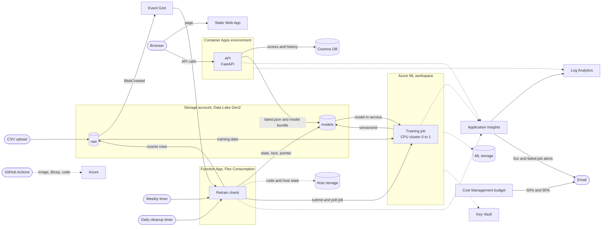

# Architecture

## Overview



## Request path

1. The browser loads the page from the Static Web App and then calls the API directly. CORS allows the Static Web App origin, which Bicep injects, and the API's rate-limit errors carry the same CORS headers.
2. `/predict` scores one customer. `/explain` swaps each feature for the training-set median or mode and reports the change in churn probability, so it works for any model. `/batch_predict` takes up to 500 CSV rows.
3. A decision cut-off tuned for F1 turns the calibrated probability into a flag. The cut-off ships with the model and is returned with every score.
4. Each score is written to Cosmos DB after the response is sent, tagged with a random session id the browser generates. Single scores keep the feature values; CSV scores keep only the counts. Items expire after 30 days, and `/history` returns only the caller's own session.
5. The history write is best effort: a failure is logged and never fails the request.

The API is a public demo. Anyone with the URL can score customers. `X-API-Key` and bearer-token checks exist but are off by default.

## Retraining

1. A CSV lands in the `raw` container, or the weekly timer fires. Either runs `retrain.run_retrain_check`. A blob lease on `models/retrain.lock` makes simultaneous events run one check while the others skip, and the lease is renewed while large files are counted.
2. The check streams every new or changed CSV through a real CSV parser. A file missing the required columns (including `Exited`) is reported and ignored. Rows already used by a training run are not counted again, and an appended file counts only its new rows. Counts are cached per file in `models/retrain_baseline.json`, so rows below the threshold keep accumulating across checks.
3. At 1000 untrained rows it submits `training/train.py` as an Azure ML job, writes `models/retrain_pending.json` and stops. Later checks poll the job and wait while it runs. A job that finishes moves the training baseline forward whether it published or was rejected by the gate. A job that fails keeps the rows for a retry after six hours and logs `retrain job failed`, which raises an email alert.
4. The job reads every valid CSV in `raw`, de-duplicates on `CustomerId`, and sends 20% of customers to the held-out set by hashing `CustomerId`, so a customer stays in or out of the held-out set as data grows. It fits five calibrated models, tunes each cut-off on out-of-fold predictions and keeps the best cross-validated F1.
5. The job also scores the model in service on the new held-out rows. It writes nothing if the new model does worse, or if the recall gap between countries or genders grows by more than 0.10.
6. A published bundle goes to a new folder, `models/versions/<id>/`, never over an existing one. Once the job completes the Function checks that the folder holds a manifest and then writes `models/latest.json`, which points at it. The pointer is the last write, so the API never sees half a bundle. The daily timer keeps the five newest versions.
7. The API loads the model baked into the image, then every five minutes reads `latest.json`. A strictly newer bundle is downloaded, checked against its SHA-256 manifest and swapped in without a restart. A bundle that fails the check is ignored.

Model bundles are Python pickles. They are only read from the `models` container, which only the Function and Azure ML identities can write. The manifest detects corruption, not a hostile writer, so write access to that container is the trust boundary.

## Identity and access

Data access uses managed identity. The exceptions are the shared key that Container Apps uses to send logs to Log Analytics, and the Application Insights connection strings in app settings.

| Identity | Access |
|---|---|
| Container App | Storage Blob Data Reader on the `models` container, Cosmos DB data contributor |
| Function App | Blob Data Reader on `raw`, Blob Data Contributor on `models`, Blob Data Owner, Queue Data Contributor and Table Data Contributor on its own host storage account, AzureML Data Scientist on the workspace |
| Azure ML workspace and cluster | Storage Blob Data Contributor on the data lake account |
| GitHub Actions (OIDC) | Contributor and User Access Administrator on the resource group |

The Function's host storage is a separate account without hierarchical namespace, with shared-key access turned off.

## Services

| Service | Role | Configuration |
|---|---|---|
| Container Apps | Runs the FastAPI service | 0.5 vCPU and 1 GiB, scales from 0 to 1 replicas. Startup and readiness probes use `/ready`, liveness uses `/health` |
| Static Web Apps | Hosts the web page | Free SKU, no build step |
| Cosmos DB | Stores scores for the history view | One container partitioned by day, 30 day expiry, 400 RU/s |
| Storage (Data Lake Gen2) | `raw` holds uploaded training CSVs, `models` holds retrain state, model versions and the pointer | Locally redundant |
| Storage (host) | Function package and host state | Separate account, shared-key access off |
| Event Grid | Sends a message when a CSV lands in `raw` | System topic on the data lake account |
| Functions | Decides whether to retrain, on upload and on a timer, and tidies old versions daily | Python 3.11, Flex Consumption |
| Azure ML | Runs the training job | Workspace plus a `Standard_DS2_v2` cluster that scales to zero |
| Key Vault, ML storage | Dependencies of the ML workspace | Standard |
| Log Analytics and Application Insights | Logs, traces, a 5xx alert and a failed-retrain alert | 30 day retention, 0.15 GB daily cap |
| Cost Management | Monthly budget with mail at 50% and 90% | Set by `ALERT_EMAIL` |

## Scaling and cost controls

- The API scales to zero when idle, so the first request after a quiet period takes about 15 seconds. It never runs more than one replica.
- The Azure ML cluster has a minimum of zero nodes and shuts down two minutes after a job finishes.
- Log ingestion has a daily cap.
- `ALERT_EMAIL` enables a $10 monthly budget, an alert when the API returns more than five 5xx responses in 15 minutes, and an alert when a retrain job fails.

## Regions

Everything runs in centralindia except the Static Web App, which runs in eastasia because the service is not offered in centralindia.

## Stopping everything

```bash
az containerapp ingress disable -g $RESOURCE_GROUP -n churnlearn-dev-api
az functionapp stop -g $RESOURCE_GROUP -n <function app name>
```

Or delete the group with `az group delete -n $RESOURCE_GROUP`.
